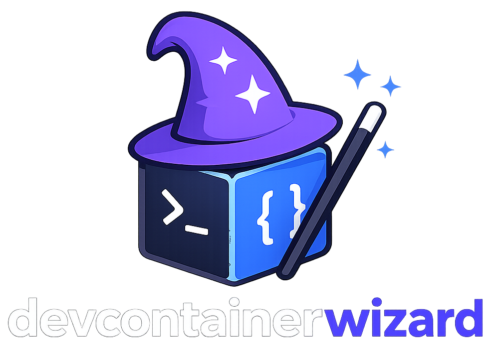

<!-- markdownlint-disable MD033 -->
<p align="center">
  
</p>

<h1 align="center">devcontainerwizard</h1>

<p align="center">
  <strong>A short, human-friendly YAML in; a valid <code>devcontainer.json</code> out.</strong><br>
  Every field documented, validated before it is written.
</p>

<p align="center">
  
  
  
</p>

<p align="center">
  <a href="https://lucasassuncao.github.io/devcontainerwizard/">Website</a>
  &nbsp;·&nbsp;
  <a href="https://lucasassuncao.github.io/devcontainerwizard/docs/">Documentation</a>
</p>
<!-- markdownlint-enable MD033 -->

Hand-writing `devcontainer.json` means guessing which keys are legal, what `onAutoForward: openBrowserOnce` actually does, and whether the file you just saved will even start a container. devcontainerwizard is for that: you write a short `config.yaml`, it tells you what every field means while you edit, and it refuses to write a document the [Dev Containers specification](https://containers.dev/implementors/spec/) would reject.

You write this:

```yaml
name: my-project
image: mcr.microsoft.com/devcontainers/base:ubuntu
remoteUser: vscode
forwardPorts:
  - 3000
```

You run `devcontainerwizard convert`, and VS Code offers to reopen the folder in a container.

---

## Highlights

| | |
| --- | --- |
| 📦 **Templates** | `init --template` starts from a minimal image, a Dockerfile, Docker Compose, Go, Python, Rust, DevOps, or a fully annotated example. |
| ✍️ **Two-panel editor** | Check a field on and it is inserted with a working snippet, already indented. The hint panel shows its description, default and allowed values without leaving the editor. |
| 🧩 **Presets** | `p` inside a block offers ready-made values for that field; `p` on the root list swaps in a whole template. |
| ✅ **Validated twice** | The editor validates on every save and `convert` validates again before writing. Required fields, enums, ranges, URL formats and deprecations are all checked. |
| 🔗 **Cross-field rules** | The mistakes a schema cannot catch: `image`, `build` and `dockerComposeFile` are mutually exclusive, and `service` only means something alongside `dockerComposeFile`. |
| 🧠 **Editor completion** | A generated JSON Schema for `config.yaml`, so VS Code completes and validates it as you type. |
| 📚 **One source of truth** | Each field is described once, next to its Go struct. The hint panel, the validators, the reference pages and the JSON Schema are all generated from it, so the docs cannot drift from the tool. |

## Install

```bash
go install github.com/lucasassuncao/devcontainerwizard@latest
```

Or grab a binary from [Releases](https://github.com/lucasassuncao/devcontainerwizard/releases), or build from source:

```bash
make build          # goreleaser, current platform
make install        # go install
```

`devcontainerwizard self-update` upgrades the binary in place from GitHub releases.

## Getting started

```bash
devcontainerwizard init --list          # see the available templates
devcontainerwizard init -t golang       # write config.yaml from one
devcontainerwizard edit                 # optional: refine it in the TUI
devcontainerwizard convert              # write .devcontainer/devcontainer.json
```

`convert` warns when the output path is not one VS Code auto-detects (`.devcontainer/devcontainer.json` or `.devcontainer.json`). See [docs/GETTING-STARTED.md](docs/GETTING-STARTED.md) for the full walkthrough, including editor completion for `config.yaml`.

## Commands

| Command | Does |
| --- | --- |
| `devcontainerwizard init -t <name>` | writes `config.yaml` from a template |
| `devcontainerwizard init --list` | lists the templates |
| `devcontainerwizard edit` | opens the two-panel editor |
| `devcontainerwizard edit --theme <name>` | renders it with a named colour theme |
| `devcontainerwizard edit --list-themes` | browses the available themes |
| `devcontainerwizard convert` | writes `.devcontainer/devcontainer.json` |
| `devcontainerwizard show-examples` | browses the built-in presets for every field |
| `devcontainerwizard self-update` | installs the latest release from GitHub |
| `devcontainerwizard self-update --list` | shows the available releases |
| `devcontainerwizard self-update --version <tag>` | installs one release by tag instead of the latest |

`--config, -c` points any command at another file. See [docs/COMMANDS.md](docs/COMMANDS.md) for every flag.

## The editor

The left panel lists the top-level keys of `config.yaml`; `enter` opens a block, where `space` checks a sub-field on and `enter` edits its value. `h` toggles the hint panel, `ctrl+s` saves, `ctrl+e` saves and writes `.devcontainer/devcontainer.json` in one go, `ctrl+u` and `ctrl+y` undo and redo, and `esc` backs out of a block or quits from the root list.

Saving validates the whole document first and refuses to write a broken one. `--no-validate-on-save` lifts that when you know better, and `--dump` records the session to attach to a bug report.

See [docs/EDIT.md](docs/EDIT.md) for every panel and key.

## Reference

Every field of the schema has a generated page with its description, type, default and allowed values, starting at [docs/devcontainerwizard/attributes/devcontainer.md](docs/devcontainerwizard/attributes/devcontainer.md). [docs/CONFIGURATION.md](docs/CONFIGURATION.md) covers what goes in `config.yaml`, and [docs/COOKBOOK.md](docs/COOKBOOK.md) has recipes for common setups.

## How it is built

Every field is described exactly once, in `internal/model`, next to the Go struct that defines it. The editor's hint panel, the validators, the reference pages and the JSON Schema are projections of that single source, and tests fail when a top-level field is missing its metadata or its preset. The TUI itself is [yedit](https://github.com/lucasassuncao/yedit), a generic schema-driven YAML editor.

See [docs/ARCHITECTURE.md](docs/ARCHITECTURE.md) for the layout, [docs/DEVELOPMENT.md](docs/DEVELOPMENT.md) to build and test it, and [docs/RELEASING.md](docs/RELEASING.md) for cutting a release. Contributions: [CONTRIBUTING.md](CONTRIBUTING.md).

## License

Released under the [MIT License](LICENSE).
